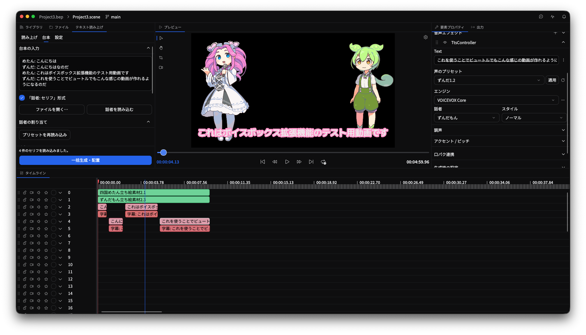
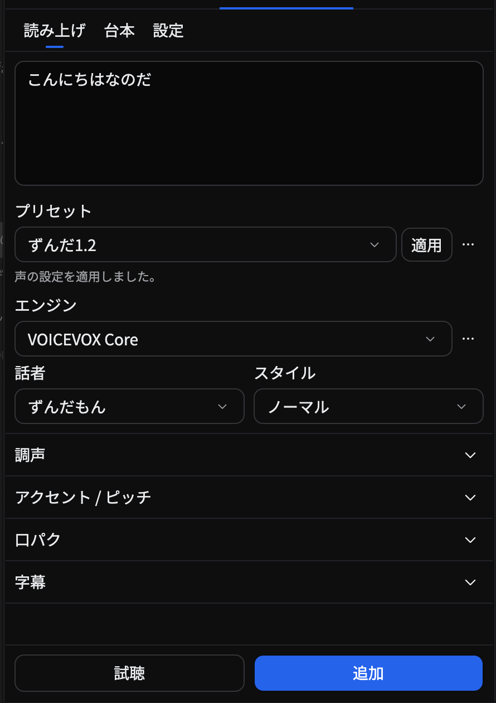
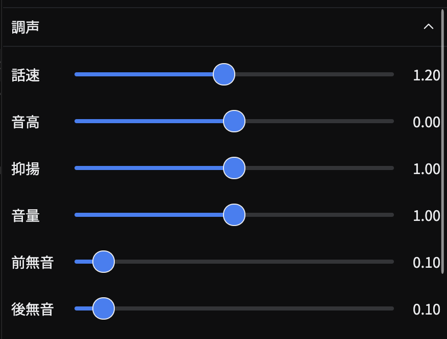
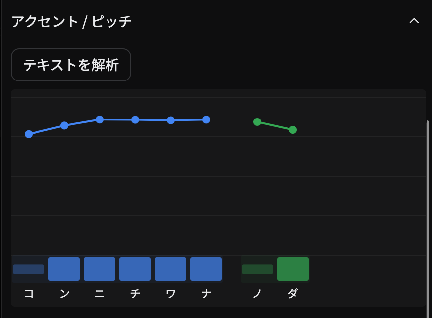
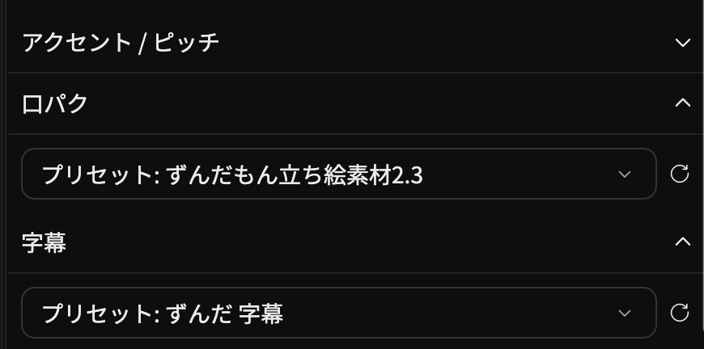
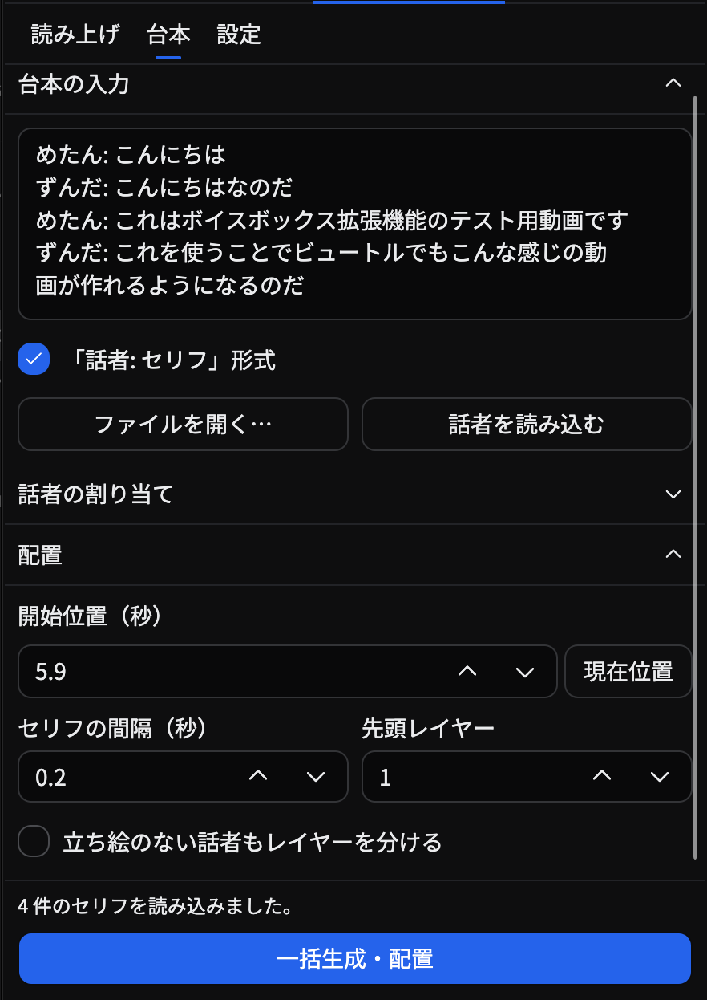
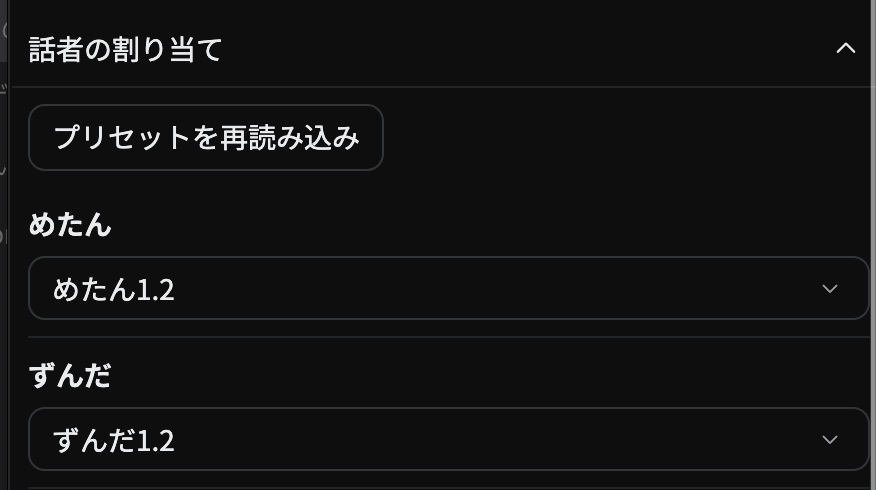

# Beutl.Extensions.Voice

Beutlにテキスト読み上げ機能を追加する拡張機能です。
内蔵の VOICEVOX Core と、外部の VOICEVOX 互換 HTTP エンジン、インストール済みの [AquesTalkPlayer](#aquestalkplayer-を使う) を使用できます。
Beutlのブラウザタブで[ゆっくり音声サイト](#ゆっくり音声サイトから取り込む)からダウンロードした音声も、立ち絵・字幕付きで追加できます。



「テキスト読み上げ」タブの上部で、次の4つの画面を切り替えられます。

| 画面 | 主な用途 |
| --- | --- |
| 読み上げ | テキストの入力、声の調整、試聴、音声の追加、プリセットの管理 |
| 台本 | 複数のセリフの読み込み、話者へのプリセットの割り当て、一括生成・配置 |
| 辞書 | 単語の読み・アクセントの登録、試聴、辞書の入出力 |
| 設定 | インストール済みの外部エンジン・AquesTalkPlayerの検索・登録、ゆっくり音声サイトの声の割り当て |

読み上げと台本の入力は、画面を切り替えても保持されます。
初めて使う場合は、[エンジンを設定](#エンジンの設定)してから[音声を作成](#新しい音声を作成する)してください。

## 目次

- [エンジンの設定](#エンジンの設定)
- [音声の作成・編集](#音声の作成編集)
- [声のプリセット](#声のプリセット)
- [ユーザー辞書](#ユーザー辞書)
- [台本の一括読み込み](#台本の一括読み込み)
- [PSD立ち絵との口パク連携](#psd立ち絵との口パク連携)
- [字幕](#字幕)
- [ゆっくり音声サイトから取り込む](#ゆっくり音声サイトから取り込む)
- [MCPからの操作](#mcpからの操作)
- [保存されるデータ](#保存されるデータ)
- [困ったときは](#困ったときは)
- [開発時の検証](#開発時の検証)
- [ライセンス](#ライセンス)

## エンジンの設定

内蔵 Core と外部エンジンは、読み上げ・既存音声の編集・台本のプリセットで共通に利用できます。
**外部エンジンだけを使う場合、内蔵 Core のインストールは不要です。**

### 内蔵の VOICEVOX Core を使う

初回の案内、または「エンジン」横の「…」→「VOICEVOX Coreをインストール…」からセットアップします。

- **今はスキップ**：セットアップを後回しにします。後から同じメニューでインストールできます。
- **今後表示しない**：起動時の通知とタブ内の案内を非表示にします。再起動後も設定を保持します。

### インストール済みの外部エンジンを登録する

VOICEVOX・AivisSpeech・SHAREVOXをインストール済みの場合は、次の手順で登録できます。

1. 「テキスト読み上げ」タブ上部の「設定」を開きます。
2. 「音声エンジンを探す」に、エンジンごとの状態が表示されます。起動しているエンジンは「読み上げで使う」を押すと、登録して「読み上げ」で選びます。起動していないアプリは「起動して使う」で起動してから登録します。

登録済みのエンジンには「登録済み」と表示されます。もう一度「読み上げで使う」を押すと、話者の一覧などを最新にします。
初回の案内の「エンジンを探す…」やエンジンメニューからも、この画面を開けます。
通常の配置場所で見つからないアプリや単体エンジンは「アプリの場所を指定…」から指定してください。

> 検索だけではアプリを起動しません。登録後も、音声生成には外部エンジンの起動が必要です。

### URLを指定して登録する

ポートを変更している場合や、別のPCのエンジンを使う場合は、接続先を直接指定します。

1. 外部エンジンを起動します。
2. 「エンジン」横の「…」→「接続先を追加…」を開きます。
3. 表示名と送信先URLを入力し、「接続して保存」を押します。
4. 話者・スタイルを選んで、試聴・音声生成します。

接続先には任意の HTTP / HTTPS URL を指定できます。標準のURLは次のとおりです。

| エンジン | 標準の接続先URL |
| --- | --- |
| VOICEVOX ENGINE | `http://127.0.0.1:50021` |
| AivisSpeech Engine | `http://127.0.0.1:10101` |
| SHAREVOX ENGINE | `http://127.0.0.1:50025` |

登録したURLはエンジンの下に表示されます。「…」から接続先の編集・削除、接続確認、話者一覧の再読み込みができます。

VOICEVOX ENGINE 0.26.0 と AivisSpeech Engine 1.2.0 で、生成・再生成・台本の一括生成を確認しています。
SHAREVOXなど、話者一覧・AudioQuery・WAV合成のAPIが共通のエンジンにも同じ接続方法を使えます。

### AquesTalkPlayer を使う

[AquesTalkPlayer](https://www.a-quest.com/products/aquestalkplayer.html)（Windows版・Mac版）をインストール済みの場合は、AquesTalkPlayerのプリセットを話者にして音声を作成できます。
アプリは同梱していないため、公式サイトから入手してください。この拡張機能は、公式マニュアルに記載のコマンドラインでアプリを呼び出します。

1. 「テキスト読み上げ」タブ上部の「設定」を開きます。
2. 「AquesTalkPlayer」の状態とプリセット数を確認し、「読み上げで使う」を押します。見つからない場合は「アプリの場所を指定…」で指定します。
3. 「読み上げ」でエンジンに「AquesTalkPlayer」を選び、話者（プリセット）を選んで試聴・追加します。

アプリは次の場所から探します。

| OS | 探す場所 |
| --- | --- |
| Windows | デスクトップ・ダウンロード・ドキュメント・ユーザーフォルダー・Cドライブ直下などに展開した `aquestalkplayer` フォルダー（`aquestalkplayer_日付` フォルダーの中を含む） |
| Mac | `/Applications` と `~/Applications` の `AquesTalkPlayer.app` |

AquesTalkPlayerの声は、VOICEVOX系のエンジンと次の点が異なります。

- **話者とスタイル**：話者にはプリセット名、スタイルには声種（例：`AquesTalk1 f1`）を表示します。
- **調声**：AquesTalkPlayerと同じ棒読み・話速・音量・音程（AquesTalk10では高さ・アクセント・声質も）と、前無音・後無音を調整できます。話者を選ぶと、そのプリセットの値が入ります。前無音・後無音は、AquesTalkPlayerが付けた前後の無音を指定の長さに置き換えます。
- **値の反映**：プリセットと異なる値で生成するときは、AquesTalkPlayerのプリセットファイルに一時的なプリセット `Beutl_temp` を書き込んで読み上げ、終わったら元の内容に戻します。Windows版では、AquesTalkPlayerを書き込みできるフォルダーに展開してください。
- **プリセットの更新**：プリセットを追加・名前変更した場合は、エンジン横の「…」→「接続確認・再読み込み」で一覧を更新します。プリセットの値を変えた場合は、再読み込みしてから話者を選び直すと反映されます。
- **読みとアクセント**：ふだんはAquesTalkPlayerが読みとアクセントを決めます。「調声」の「VOICEVOXで解析」をオンにすると、VOICEVOX Coreで解析した読みとアクセントを音声記号列（`#>` で始まる読み）に変換してAquesTalkPlayerに渡します。オンのときは「アクセント」が表示され、「テキストを解析」の後にアクセントの位置を変更できます。
  - 解析にはVOICEVOX Coreのインストールが必要です。VOICEVOXのユーザー辞書も解析に効きます。
  - 「テキストを解析」を押さずに試聴・追加した場合は、そのときに解析します。
  - ピッチと長さはAquesTalkPlayerに渡せないため、編集できるのはアクセントの位置だけです。
  - 棒読みのプリセットでは、アクセントは読みに反映されません。
  - 本文を変更すると、編集したアクセントは破棄されます。
  - オフの場合は、AquesTalkPlayerのユーザ辞書か、本文の行頭に `#>` を付けた音声記号列で読みを指定できます。音声記号列は字幕にもそのまま表示されます。
- **辞書**：「辞書」タブでは編集できません。AquesTalkPlayerのユーザ辞書設定を使ってください。
- **サンプリングレート**：[ゆくも!](#音声を追加する)と同様に、音声エフェクトの先頭へ「リサンプリング」（方式：4点Lagrange）を付けて追加し、試聴でも同じ方式でプロジェクトのサンプリングレートに変換して再生します。再生成時にリサンプリングがなければ追加し、無効にしたものはそのままにします。AquesTalkPlayerの環境設定で「サンプリング周波数を一定にする」をオフにすると、エンジン本来のサンプリングレート（8kHz・16kHzなど）からLagrangeで変換されます。
- **Windows版の文字**：Shift_JISで表せない文字（絵文字など）と半角の `"` を除いてアプリに渡します。

無償で使えるのは、個人の非営利利用に限られます。それ以外の用途では、AquesTalkPlayerの「使用ライセンス」を購入して設定してください。詳しくは[公式の利用条件](https://www.a-quest.com/products/aquestalkplayer.html)を参照してください。

AquesTalkPlayer for Mac 1.0.2 で、プリセットの読み込み・音声生成・一時プリセットによる値の反映・VOICEVOX Coreで解析したアクセントの反映を確認しています。

## 音声の作成・編集

### 新しい音声を作成する

1. 「テキスト読み上げ」タブの「読み上げ」を開き、本文を入力します。
2. エンジン・話者・スタイルを選びます。保存済みの[声のプリセット](#声のプリセット)も使えます。
3. 必要に応じて「調声」や「アクセント / ピッチ」で声を調整します。
4. 下部の「試聴」で音声を確認し、「追加」でタイムラインに配置します。



「追加」はタイムラインの選択状態にかかわらず、新しい読み上げ要素を作成します。
追加した音声と設定は、まとめて Undo/Redo できます。

### 声を調整する

読み上げタブと既存音声の編集では、共通の編集UIを使います。エンジンが対応する調声項目のみ表示します。

| 設定 | 調整できる内容 |
| --- | --- |
| 調声 | 話速・音高・抑揚・音量・前後無音 |
| アクセント / ピッチ | 「テキストを解析」後、発音ごとのアクセントやピッチを編集 |
| 感情（AivisSpeech） | スタイルの感情表現の強さ |
| 緩急（AivisSpeech） | 話す速さの緩急 |

AivisSpeechの「感情」「緩急」はプリセットにも保存できます。
モーラごとの編集には対応していないため、AivisSpeechでは「アクセント / ピッチ」を表示しません。
AquesTalkPlayerでは、AquesTalkPlayerと同じ棒読み・話速・音量・高さ・アクセント・声質・音程と、前無音・後無音を表示します。
AquesTalkPlayerの「アクセント」は「調声」の「VOICEVOXで解析」をオンにすると表示され、アクセントの位置だけを編集できます（[詳しく](#aquestalkplayer-を使う)）。

| 調声 | アクセント / ピッチ |
| --- | --- |
|  |  |

### 口パクと字幕を設定する

「口パク」でPSD立ち絵のテンプレートを、「字幕」で字幕テンプレートを選択します。
選択内容は声のプリセットに保存できます。
詳しくは[PSD立ち絵との口パク連携](#psd立ち絵との口パク連携)と[字幕](#字幕)を参照してください。



### 既存の音声を編集・再生成する

1. タイムライン上の読み上げ要素の `TtsController` を開きます。
2. 本文・話者・スタイルを変更するか、「声のプリセット」を選んで「適用」します。
3. 必要に応じて「調声」や「アクセント / ピッチ」で調整します。
4. 「再生成」を押し、編集内容を音声に反映します。

「生成時の設定」には、前回の生成に使った値を表示します。再生成前の設定とアクセント編集も要素内に保存され、再度開いて編集を続けられます。

- **再生成で更新するもの**：その要素の音声と生成時設定。
- **保持するもの**：配置・長さ・トリム・エフェクト。
- **アクセントの引き継ぎ**：本文と声が同じ場合は手編集したアクセントを保持し、本文や声を変えた場合は解析し直します。
- **Undo/Redo**：設定の編集、プリセットの適用、音声の再生成に対応します。スライダーのドラッグは1操作として戻せます。

## 声のプリセット

エンジン・話者・スタイルと調声値を保存し、読み上げ・既存音声の編集・台本の生成で再利用できます。
どのプロジェクトでも共通で使え、未保存のプロジェクトやシーンでも保存できます。

### 保存・適用する

1. 「読み上げ」でエンジン・話者・スタイルを選び、声を調整します。
2. プリセット欄の右の「…」→「現在の設定を保存…」で保存します。
3. 再利用するときは、一覧からプリセットを選んで「適用」を押します。

保存対象は、エンジン・話者・スタイル、話速・音高・抑揚・音量・前後無音などの調声値です。
口パクに使うPSD立ち絵と字幕テンプレートも保存できます。
「…」メニューでは、更新・複製・名前の変更・削除と、保存値との差分の確認もできます。

### 既存の音声への影響

プリセットを更新・削除しても、既存の音声・生成時設定・適用済みの設定は変わりません。
既存の音声に変更を反映する場合は、`TtsController` でプリセットを適用し、再生成してください。

プリセット・接続先・話者は表示名ではなく ID で識別するため、異なるエンジンに同じ話者名やスタイル番号があっても混同しません。
保存した声を使えなくなった場合は、[困ったときは](#困ったときは)を参照してください。

## ユーザー辞書

「辞書」タブで編集するエンジンを選び、単語の読みやアクセントを登録できます。
辞書画面のエンジン・試聴用の声は、読み上げ画面の選択から独立しています。
AquesTalkPlayerの辞書は、AquesTalkPlayerのユーザ辞書設定で編集します。

1. 一覧の「追加」、または登録済みの単語を選ぶと編集画面が開きます。表記と読み（全角カタカナ）を入力します。
2. 読み上げタブと同じモーラのバーをクリックするか、数値でアクセント位置を設定します。`0` は平板型で、それ以外は音が下がる直前のモーラの位置です。品詞と優先度は「詳細」で設定します。優先度は0〜10で、数字が大きいほど解析に使われやすくなります。
3. 下部の「試聴」で確認します。話者名を開くと声を選べます。保存前にも単語の読みとアクセントを試聴できます。
4. 「保存」で辞書に反映して一覧に戻ります。上部の矢印でも一覧へ戻れます。未保存の変更がある場合は保存・破棄を選べます。削除は一覧の各単語のボタンから行い、確認後に反映されます。

辞書はエンジンごとに保存され、プロジェクト共通で使います。内蔵 Core の辞書は Core の再インストール後も残ります。
外部エンジンの辞書を編集すると、そのエンジンを利用するVOICEVOXやAivisSpeechなどのアプリにも変更が反映されます。
外部アプリで辞書を変更した場合は「…」→「再読み込み」で最新の一覧を取得してください。
AivisSpeechでは複数のアクセント句と、人名・地名などの固有の品詞も編集できます。
辞書に保存できるのはアクセント位置です。モーラごとの音高は読み上げ側の「アクセント / ピッチ」で調整してください。

### 辞書を別のエンジンへ移す

エンジン横の「…」→「エクスポート…」でJSONファイルに保存し、移動先のエンジンを選んで「…」→「インポート…」で読み込みます。
Core／VOICEVOX形式とAivisSpeech形式に対応し、UUIDを保持します。
取り込み前に、単語ごとの互換性とUUIDの重複を確認して対象を選べます。
既存の単語は初期設定では保持され、「登録済みの単語を上書き」を選ぶと置き換えます。
移動先で扱えない複合アクセントや品詞は、理由を表示して取り込み対象から外します。

### 解析済みの音声に反映する

辞書更新後、未解析の読み上げと台本は次の解析・生成から新しい辞書を使います。
解析済みの音声は手調整したアクセントを保持するため、「テキストを解析」で再解析してから試聴・生成してください。
辞書を更新しただけでは、タイムライン上の生成済み音声は変わりません。

## 台本の一括読み込み

複数のセリフにプリセットを割り当て、まとめて音声を生成・配置できます。
使いたい声は、あらかじめ「読み上げ」で[プリセットとして保存](#保存適用する)してください。

### 1. 台本を入力する

「台本」を開き、台本を貼り付けるか「ファイルを開く…」でテキストファイルを読み込みます。
「話者: セリフ」形式と、話者名を含まない1行1セリフの形式に対応しています。

```text
案内役: こんにちは。
ゲスト: よろしくお願いします。
案内役: それでは始めましょう。
```

区切りには全角の「：」も使えます。話者名を含まない台本では、**「話者: セリフ」形式**のチェックを外します。



### 2. 話者にプリセットを割り当てる

1. 「話者を読み込む」を押します。
2. 「話者の割り当て」の選択欄で、名前ごとにプリセットを選びます。
3. 新しく保存したプリセットが見つからない場合は、「プリセットを再読み込み」で一覧を更新します。

選んだプリセットのエンジン・話者・スタイル・調声値を生成に使います。話者ごとに異なる接続先も指定できます。

本文の確認・修正は「台本の入力」で行います。生成には入力欄の最新の内容を使い、同じ話者名への割り当ては保持します。
話者名を変更した場合は、「話者を読み込む」で割り当てを更新してください。



### 3. 生成してタイムラインに配置する

1. 開始位置・セリフ間の間隔・先頭レイヤーを指定します。
2. 立ち絵のない話者は、同一レイヤーに順番に配置するか、「立ち絵のない話者もレイヤーを分ける」を選びます。レイヤーを分ける場合は、話者の登場順に配置します。
3. 「一括生成・配置」を押します。

各セリフの開始位置は、実際の音声の長さと指定した間隔から決まります。
生成後は各要素の `TtsController` で調整・再生成できます。

立ち絵付きプリセットの話者は、次のように配置します。

- 「立ち絵・音声・字幕」の順に配置します。字幕がない話者は「立ち絵・音声」の2段です。
- 新規追加する立ち絵は台本全体の開始から終了まで表示し、話者の組の間に空きレイヤーを挟まず並べます。
- 既存の立ち絵を使う場合はその下から、重なりやロックのない場所に音声と字幕を隣接して配置します。

配置結果の編集・取り消しについては、次の操作に対応しています。

- 生成した要素は、まとめて Undo/Redo できます。
- 途中の失敗・中止・配置先の重なりやロックがある場合は、一部だけを残さず配置を取り消します。
- 台本と割り当てはタブに残り、タブの保存・復元にも対応しています。未割り当ての話者がいても、入力を失わずにプリセットを選んで再実行できます。

## PSD立ち絵との口パク連携

PsdTachie拡張の立ち絵の要素、またはPSD立ち絵のオブジェクトを「テンプレートとして保存」します。「読み上げ」の「口パク」でそのテンプレートを選んでから、声のプリセットを保存します。口・目のパーツ選択や閾値、位置・サイズなど、立ち絵のオブジェクト設定も保存します。PSDファイル自体はコピーせず、元のファイルを参照します。「台本」では話者ごとにこのプリセットを選ぶだけで、生成時に口パクを設定できます。音声の配置と立ち絵への連携はまとめて Undo/Redo できます。

「口パク」の候補は、PSD立ち絵単体のテンプレートと、PSD立ち絵を1つだけ含む要素・グループのテンプレートです。タイムライン上の立ち絵は候補に含めません。要素・グループのテンプレートから使うのはPSD立ち絵のオブジェクトだけで、同じ要素内の他のオブジェクトは追加しません。プリセットを使わずにテンプレートを選んで生成することもできます。連携先の初期値は「連携しない」です。

生成時は、同じPSDファイルを参照する立ち絵がシーンにあれば、その設定を保って連携します。複数ある場合は音声の区間に重なる立ち絵を優先します。見つからない場合はテンプレートやプリセットに保存したオブジェクトを追加し、生成した音声の区間に合わせて表示します。テンプレートやプリセットから追加した立ち絵は後の生成に合わせて前後へ延長し、手動で配置した立ち絵の表示区間は維持します。

立ち絵は長い1つの要素のまま、下のレイヤーに間隔を空けてセリフを並べられます。同じ立ち絵に連携した音声は再生位置に応じて切り替わり、セリフの前後と間では口を閉じます。

生成済みの音声は、その要素の `TtsController` で「口パク連携」を開き、立ち絵のテンプレートを選んで「連携」すると連携先を設定・変更できます。連携先の決め方は生成時と同じで、すでに同じPSDファイルの立ち絵に連携している音声はそのままにします。現在の連携先は「口パク連携」の先頭に表示します。

口・目のレイヤーや音量の閾値は立ち絵側で設定します。音声の再生成・差し替え、移動・トリム・速度変更、音声と立ち絵の分割後も連携を引き継ぎます。無音区間や連携音声のない時間は口を閉じ、音声レイヤーのミュート・ソロも反映します。連携した音声が重なる場合は、開始時刻が新しい要素を優先します。

最後の読み上げ要素で「解除」するか別の立ち絵に変更すると、元の口パク音声・開始位置の設定に戻ります。連携の変更は Undo/Redo に対応し、シーンを開き直しても保持されます。PsdTachieを導入していなくても、読み上げと再生成は利用できます。

口パクには音声ファイルの音量を使い、PsdTachieの既存の2段階・3段階の口形を切り替えます。音声エフェクト適用後の音量や音素ごとの母音口形には対応していません。

## 字幕

「読み上げ」の「字幕」で「標準字幕」またはライブラリに保存したテンプレートを選ぶと、音声と同じ区間に字幕を追加します。テキスト単体と、テキストを含む要素・グループのテンプレートを選べます。タイムライン上の要素は候補に含めません。「字幕なし」では音声だけを生成します。字幕付きの声のプリセットを保存すると、「台本」でも話者ごとにその字幕テンプレートを使います。

テンプレートの文字装飾・位置・背景などはコピーして保持します。テキストが1つなら本文を置き換え、複数ある場合は字幕にする箇所に `{text}` を指定します。例えば `「{text}」` と固定の話者名を別々のテキストにできます。音声や以前の読み上げ連携はテンプレートに含めません。

字幕は対応する音声の直下のレイヤーに、同じ開始位置・長さで配置します。配置先に既存の要素やロックがある場合は、音声と字幕をまとめて空いている連続したレイヤーへ配置します。

音声の `TtsController` で再生成すると、関連する字幕の本文も更新します。配置後に調整した見た目・表示区間は保持し、音声と字幕の更新をまとめて Undo/Redo できます。字幕の「字幕連携」を無効にすると本文の更新を停止できます。

## ゆっくり音声サイトから取り込む

Beutlのブラウザタブで次のサイトから音声をダウンロードすると、「読み上げ」の「追加」と同じように、`TtsController` 付きの読み上げ要素として再生位置に追加します。声ごとに選んだ立ち絵との口パク連携と字幕も、まとめて配置します。

| サイト | 対応ページ |
| --- | --- |
| ゆっくりボイスメーカー | `https://tts.siyukatu.com/maker` |
| ゆくも! | `https://www.yukumo.net/`（Proページを含む） |

この機能には、ブラウザのダウンロードを拡張機能に渡す API（`BrowserDownloadExtension`）と「リサンプリング」エフェクトに対応した Beutl が必要です。

### 音声を追加する

1. プロジェクトとシーンを保存してから、ブラウザタブで対応サイトを開きます。
2. サイトで本文と声を選び、サイトの保存（ダウンロード）ボタンを押します。
3. ブラウザタブ下部の「このページからのダウンロード要求」で「ダウンロード」を押します。保存先は聞かれず、プロジェクトの `resources/downloads` に保存します。
4. 初めて使う声では、立ち絵（口パク）と字幕を選ぶ画面が開きます。「追加」を押すと、次からはその声の音声に同じ立ち絵と字幕を自動で使います。

- 本文は、サイトがダウンロードを始めた時点の入力欄から読み取り、`TtsController` の本文と字幕に使います。
- 立ち絵は、PSD立ち絵のテンプレートか、立ち絵付きの声のプリセットから選べます。「テキスト読み上げ」タブを開いている場合は、その「口パク」「字幕」の選択が初期値になります。
- 配置の規則と Undo/Redo は「追加」ボタンと同じです。詳しくは[PSD立ち絵との口パク連携](#psd立ち絵との口パク連携)と[字幕](#字幕)を参照してください。
- ゆくも!の音声は、Beutl 標準のサンプリングレート変換ではこもって聞こえるため、音声エフェクトの先頭に「リサンプリング」（方式：4点Lagrange）を付けて追加します。方式は要素のプロパティで変更できます。エフェクトを無効にすると標準の変換に戻ります。
- 選択画面で「キャンセル」した音声は、ファイルを保存したままタイムラインには追加しません。

### 声の割り当てを変更する

選んだ立ち絵と字幕は、「テキスト読み上げ」タブの「設定」にある「ゆっくり音声サイトの声」に一覧表示します。「変更…」で選び直し、「削除」で割り当てを解除できます。解除した声は、次に音声を追加するときに選択画面を開きます。
割り当ての変更は、追加済みの音声には影響しません。

### 制限事項

- サイトで作った音声は VOICEVOX の生成時設定を持たないため、`TtsController` の「生成時の設定」は空です。話者を選ぶかプリセットを適用すれば、VOICEVOX 系エンジンで再生成できます。
- ページから本文を読み取れなかった場合は、字幕を付けずに音声と立ち絵だけを追加して通知します。`TtsController` に本文を入力してください。
- ゆっくりボイスメーカーの「複数の声」やゆくも! Proのように声を並べる画面では、そのページで最初にダウンロードした音声だけ、先頭の声として扱うことがあります。
- 生成した音声の利用条件（AquesTalk の商用ライセンスなど）は、各サイトの案内に従ってください。

## MCPからの操作

Beutl 2.0.0-preview.11 以降のライブMCPに、次の15ツールを追加します。
BeutlのMCPを有効にし、この拡張機能を読み込むと、接続済みのAIエージェントから利用できます。
外部エンジンは `voice_register_engine` または通常の[エンジンの設定](#エンジンの設定)で登録できます。Coreのセットアップと外部エンジンの起動はBeutlや各アプリで行ってください。

| ツール | 用途 |
| --- | --- |
| `voice_list_engines` | 内蔵Coreの状態と登録済みエンジン（AquesTalkPlayerを含む）のID・種類・接続先・機能を取得。外部エンジンへの接続は行いません。 |
| `voice_list_voices` | `engineId` を指定して、話者UUID・スタイルID・調声機能を取得。省略時は `voicevox-core`。外部エンジンには接続し、AquesTalkPlayerはプリセットを読み込んで最新の一覧を取得します。 |
| `voice_list_presets` | プリセットID・声の設定・口パクと字幕の有無を取得。 |
| `voice_generate` | 本文を合成し、新しい読み上げ要素をタイムラインに追加。プリセットの口パク・字幕も反映します。 |
| `voice_regenerate` | 要素IDを指定し、本文・声・調声を変更して再生成。配置・長さ・トリム・エフェクトを保持し、連携字幕を更新します。 |
| `voice_generate_script` | 台本と話者ごとのプリセットを指定して、一括生成・配置。実際の音声長に指定した間隔を加えて並べます。 |
| `voice_save_preset` | 声の設定や生成済み要素からプリセットを作成・更新。口パク・字幕の設定も保存できます。 |
| `voice_analyze` | 発音・アクセント・ピッチを含むAudioQueryを取得。音声ファイルや要素は作成しません。AquesTalkPlayerではVOICEVOX Coreで解析し、`analyzeWithVoiceVox` をオンにした声の生成でアクセント位置・アクセント句・ポーズ・読み・疑問形だけを使います。 |
| `voice_register_engine` | HTTPエンジンの接続を確認して登録。同じURLの登録では既存のID・表示名を保持します。 |
| `voice_set_lip_sync` | 既存音声の口パク候補と連携状態を取得し、連携先を変更・解除します。 |
| `voice_list_dictionary_words` | 辞書単語を検索・ページングして、単語ID・読み・アクセント句・品詞を取得。対応する品詞と複合アクセントの可否も返します。 |
| `voice_save_dictionary_word` | 辞書単語を作成・更新。更新時に省略した読み・品詞・優先度は保持します。 |
| `voice_delete_dictionary_word` | エンジンIDと単語IDを指定して削除。 |
| `voice_export_dictionary` | 単語UUIDをキーとする辞書JSONを取得。独自フィールドや複合アクセントも保持します。 |
| `voice_import_dictionary` | 辞書JSONを読み込み、互換性・重複を確認して取り込みます。書き込まない確認モードにも対応。 |

一覧取得には、開いているシーンは不要です。
タイムラインへの音声生成・再生成・口パク操作は、**呼び出し開始時にBeutlで選択されているシーン**を対象にします。シーン内の音声を生成・再生成する前にプロジェクトまたはシーンを保存してください。
シーンを切り替えても、生成先は呼び出し時のシーンです。生成中にその編集タブを閉じた場合は、配置を中止します。
Beutlを複数起動している場合は、ホストが各ツールに追加する `instanceId` で対象を指定できます。

### プリセットを使って生成する

`voice_list_presets` でIDを取得し、`voice_generate` に次の引数を渡します。
`presetId` は実際に取得したIDに置き換えてください。

```json
{
  "text": "こんにちは。今日の内容を紹介します。",
  "presetId": "00000000-0000-0000-0000-000000000001",
  "startSeconds": 2.5,
  "layer": 1
}
```

### 声を直接指定して生成する

プリセットがない場合は、`voice_list_engines` と `voice_list_voices` で得たIDを `voice` に指定します。
`presetId` と `voice` はどちらか一方を指定してください。`speakerUuid`・`styleId` は一覧で得た値に置き換えます。

```json
{
  "text": "読み上げる文章です。",
  "voice": {
    "engineId": "voicevox-core",
    "speakerUuid": "00000000-0000-0000-0000-000000000001",
    "styleId": 0,
    "speedScale": 1.2
  }
}
```

`voice` には話速・音高・抑揚・音量・前後無音・AivisSpeechの緩急を指定できます。
AquesTalkPlayerでは `engineId` に `aquestalkplayer`、`speakerUuid` にプリセット名、`styleId` に `0` を指定します。調声値は前後無音と `aquesTalkPlayerVoice` を使います。`aquesTalkPlayerVoice` は `voice_list_voices` が返すプリセットの値を変更して渡し、省略するとプリセットのまま読み上げます。`analyzeWithVoiceVox` を `true` にすると、VOICEVOX Coreで解析した読みとアクセント（`analysis` を渡した場合はその内容）で読み上げます。
`startSeconds` の省略時は呼び出し開始時の再生位置、`layer` の省略時はレイヤー1から配置します。
指定したレイヤーが重なっていたりロックされていたりする場合は、既存の読み上げUIと同じ処理で空いているレイヤーを探します。
結果は `sceneId`・`elementId`・`audioPath`・実際の `startSeconds`・`durationSeconds`・`layer`・生成に使った設定を含むJSONです。

音声・立ち絵・字幕の追加はまとめてUndo/Redoできます。生成失敗・キャンセル時は、途中の配置と生成ファイルを取り消します。
成功後の音声ファイルはRedoのために保持します。同じ生成呼び出しを繰り返すと、その都度新しい要素が追加されます。

### 既存音声を修正する

`voice_regenerate` に、生成結果やBeutl本体の `read_document` で得た要素IDを渡します。

```json
{
  "elementId": "00000000-0000-0000-0000-000000000001",
  "text": "修正した文章です。"
}
```

本文を省略すると、その要素の現在の本文を使います。声の指定を省略すると、要素に保存された編集中の調声・適用済みプリセット・生成時設定を使います。
`voice` または `presetId` を指定すると声を変更できます。本文と声が同じ場合は、保存されたアクセント・ピッチ編集を引き継ぎます。
再生成時のプリセット指定は声の変更に使い、既存の口パク先・字幕の見た目・表示区間を保持します。
音声・本文・連携字幕の変更はまとめてUndo/Redoできます。

### 台本を一括生成する

`voice_generate_script` に本文と話者ごとのプリセットIDを渡します。

```json
{
  "script": "案内役: こんにちは。\nゲスト: よろしくお願いします。\n案内役: 始めましょう。",
  "speakerPresets": {
    "案内役": "00000000-0000-0000-0000-000000000001",
    "ゲスト": "00000000-0000-0000-0000-000000000002"
  },
  "startSeconds": 0,
  "gapSeconds": 0.2,
  "firstLayer": 1,
  "separateLayers": true
}
```

話者名なしの1行1セリフ形式では、`hasSpeakerNames: false` とし、`speakerPresets` の空文字キー `""` にプリセットIDを割り当てます。
`startSeconds` は再生位置、`gapSeconds` は0.2秒、`firstLayer` は1、`separateLayers` はfalseが既定値です。
配置方法は通常の台本UIと共通で、プリセットの口パク・字幕も反映します。結果の `elements` 配列に各音声のID・開始位置・長さ・レイヤーを返します。
途中の失敗・キャンセルでは一部だけを配置せず、全セリフの生成ファイルを削除します。成功時は全体を1回のUndoで戻せます。

### プリセットを作成・更新する

`voice_save_preset` に `name` と `voice` を渡すと、シーンを開かずに声を保存できます。
生成済み要素から保存する場合は、`voice` の代わりに `elementId` を渡します。現在の声・口パク先・最初の連携字幕をコピーします。

```json
{
  "name": "案内役の声",
  "elementId": "00000000-0000-0000-0000-000000000001"
}
```

結果の `preset.presetId` を指定して再度呼び出すと、そのプリセットを更新します。省略した項目は保持され、名前だけの変更もできます。
`lipSyncTargetId` と `subtitleElementId` で、シーン内の立ち絵・字幕要素を明示して保存することもできます。`useDefaultSubtitle: true` では標準字幕を保存します。
`lipSyncTargetId: null`・`subtitleElementId: null` は、その設定を削除する指定です。
要素やテンプレートを参照する保存には編集シーンが必要ですが、プロジェクトの保存は不要です。
プリセットの保存はプロジェクト共通の設定変更で、シーンのUndo対象にはなりません。既存音声も変更しません。
MCPで保存した後は、UI側でプリセット一覧を再読み込みすると表示を更新できます。

### アクセント・ピッチを編集して合成する

1. `voice_analyze` に `text` と `voice` または `presetId` を渡します。
2. 戻り値の `analysis.audioQuery.accent_phrases` 内の `accent` や、`moras` 内の `pitch` を編集します。エンジンが返した他の項目は保持してください。
3. 編集した `analysis` オブジェクト全体を、`voice_generate` または `voice_regenerate` の `analysis` 引数に渡します。

`analysis.text` と `analysis.settings` のエンジンID・話者UUID・スタイルIDは、生成する本文と声に対応します。
本文や声を変える場合は再解析してください。話速・音量などの全体調声には、生成時の声の設定を使います。
モーラ編集が可能かどうかは `voice_list_voices` の `capabilities.editAccent` で確認できます。AivisSpeechではモーラ編集に対応していません。

### HTTPエンジンを登録する

起動済みエンジンに対して `voice_register_engine` を呼び出します。

```json
{
  "url": "http://127.0.0.1:50021",
  "name": "VOICEVOX"
}
```

話者と接続情報の取得に成功した場合に登録し、結果の `engineId` を他のツールで利用できます。
接続失敗やキャンセルでは保存しません。同じ接続先の再登録では、既存のID・表示名を保ってメタデータを更新します。
登録はプロジェクト共通で、シーンのUndo対象にはなりません。

### 口パク先を変更・解除する

`voice_set_lip_sync` に `elementId` だけを渡すと、現在の連携と候補の `targets` を取得できます。
候補の `targetId` を追加して呼び出すと連携先を変更し、`targetId: null` では連携を解除します。
変更はUndo/Redoに対応します。最後の音声を解除すると、立ち絵の元の入力設定を復元します。
ロックの判定も通常のUIと共通で、既に連携済みの立ち絵に別の音声を加える操作は、立ち絵がロックされていても利用できます。

### ユーザー辞書を操作する

辞書の5ツールには、開いているシーンは不要です。`engineId` の既定値は `voicevox-core` で、HTTPエンジンには `voice_list_engines` で得たIDを指定します。

最初に `voice_list_dictionary_words` を呼び、単語ID・対応する `wordTypes`・`supportsCompoundAccent` を確認してください。
`search` は表記・読みの部分一致検索で、大文字小文字を区別しません。`offset` は0、`limit` は50が既定値です。
結果の `totalCount` は検索後の件数で、次のページは `nextOffset` を `offset` に指定して取得できます。`nextOffset: null` が最終ページです。
一覧は編集に必要な項目を返し、辞書全体の元のJSONは `voice_export_dictionary` で取得します。
`voice_save_dictionary_word` には、表記・全角カタカナの読み・アクセント位置を `phrases` 配列で渡します。

```json
{
  "engineId": "voicevox-core",
  "phrases": [
    { "surface": "試験", "pronunciation": "シケン", "accentType": 2 }
  ],
  "wordType": "PROPER_NOUN",
  "priority": 5
}
```

アクセント位置は0が平板型、1以上がアクセント核のモーラ位置です。優先度は0〜10で、新規単語の既定値は5です。
AivisSpeechでは複数の `phrases` と、人名・地名などの拡張品詞も使えます。検証・単語の構築・保存には通常の辞書UIと同じ処理を使います。
結果の `wordId` を指定して呼び出すと、その単語を更新します。例えば優先度だけを変更できます。

```json
{
  "engineId": "voicevox-core",
  "wordId": "00000000-0000-0000-0000-000000000001",
  "priority": 9
}
```

`voice_delete_dictionary_word` に同じ `engineId`・`wordId` を渡すと単語を削除します。
辞書変更はエンジン全体に反映され、シーンのUndo対象にはなりません。開いている辞書一覧の表示は再読み込みで更新できます。
解析済みのアクセントや生成済み音声は上書きしません。新しい辞書を既存音声へ反映する場合は、`voice_analyze` で本文を再解析し、返った `analysis` を `voice_regenerate` に渡してください。

### 辞書JSONを取り込む・書き出す

`voice_export_dictionary` が返す `dictionary` オブジェクトを、`voice_import_dictionary` の `dictionary` 引数へ渡せます。
単語IDとエンジン固有フィールドを保持し、対応する単語はエンジン間で形式を変換します。

- `dryRun: true`：書き込まず、互換性・重複・単語ごとのエラーと `applicableCount` を返します。
- `overwrite: false`（既定）：既存の単語IDを保持し、新しい単語だけを取り込みます。
- `overwrite: true`：同じ単語IDの内容も置き換えます。

非対応・不正な単語は結果の `entries` にエラーを返してスキップし、取り込める単語を保存します。`submittedCount` は辞書サービスへ送った単語数で、`dryRun: true` では0です。

## 保存されるデータ

| データ | 保存先・保存内容 |
| --- | --- |
| 外部エンジンの接続先 | Beutlのホームディレクトリ内の `voice/engines.json`。AquesTalkPlayerはアプリの場所と読み込んだプリセットの一覧を保存します。プロジェクト共通の設定です。 |
| 声のプリセット | Beutlのホームディレクトリ内の `voice/presets.json`。プロジェクト共通の設定です。 |
| 内蔵 Core のユーザー辞書 | Beutlのホームディレクトリ内の `voice/core-user-dictionary.json`。Coreの起動時に適用します。 |
| 外部エンジンのユーザー辞書 | 接続先エンジンに保存。各エンジンのアプリと共有されます。 |
| ゆっくり音声サイトの声の割り当て | Beutlのホームディレクトリ内の `voice/web-voices.json`。声ごとの立ち絵（PSDファイルの参照と設定）と字幕テンプレートを保存します。 |
| Coreのセットアップ案内の表示設定 | Beutl標準の拡張機能設定 |
| 読み上げ・台本の入力と話者の割り当て | タブの保存時にまとめて保存 |
| 生成した読み上げ要素 | 本文・話者・調声値・最終 AudioQuery・プリセットの識別情報。再生成前の編集内容も要素内に保存します。 |

## 困ったときは

### 外部エンジンに接続できない

外部エンジンを起動し、エンジンの下に表示される接続先URLを確認して再試行してください。
接続できない場合も、入力・設定・既存音声は保持されます。

### プリセットに保存された接続先や声が見つからない

保存された接続先が見つからない場合は、次の手順で復元できます。

1. 該当するプリセットを適用します。
2. 「エンジン」横の「…」→「接続先を編集…」からURLを設定します。

この方法では、元の接続先IDを保って復元できます。
「接続先を追加…」では同じURLでも新しいIDになるため、追加した場合は接続先・話者を選び直してプリセットを更新してください。
接続先に保存された声がない場合も、話者を選び直してください。

### AquesTalkPlayerのプリセットが見つからない

AquesTalkPlayerでプリセット名を確認し、エンジン横の「…」→「接続確認・再読み込み」で一覧を更新してください。
アプリを移動した場合は、「設定」の「アプリの場所を指定…」で指定し直してから「読み上げで使う」を押します。
AquesTalkPlayerが60秒以内に応答しない場合は、生成を中止します。AquesTalkPlayerを一度起動し、確認の画面が出ていないか確かめてください。

### 古い読み上げ要素を再生成できない

生成時設定がない古い要素は、`TtsController` で話者を選ぶかプリセットを適用すると再生成できます。

## 開発時の検証

リポジトリのルートで実行します。

```sh
dotnet test tests/Beutl.Extensions.Voice.Tests -c Release
```

### 追加の検証に使う環境変数

| 環境変数 | 指定する値 | 検証・出力内容 |
| --- | --- | --- |
| `VOICE_TEST_CAPTURES` | 画像の出力先ディレクトリ | 辞書、台本読み込み、調声、`TtsController` の設定を展開した Headless の画面画像を保存 |
| `VOICEVOX_TEST_HOME` | Core・辞書・モデルを導入済みのディレクトリ | 実音声の生成・再生成・複数話者の一括配置・設定の保持・Undo/Redo |
| `VOICE_HTTP_VOICEVOX_URL` | 起動済み VOICEVOX ENGINE のURL | 実音声での接続・生成・再生成・台本配置 |
| `VOICE_HTTP_AIVIS_URL` | 起動済み AivisSpeech Engine のURL | 実音声での接続・生成・再生成・台本配置 |
| `VOICE_HTTP_SHAREVOX_URL` | 起動済み SHAREVOX ENGINE のURL | 実音声での接続・生成・再生成・台本配置 |
| `VOICE_AQUESTALKPLAYER_PATH` | インストール済み AquesTalkPlayer の場所（Macは `.app`、Windowsは展開したフォルダーか `AquesTalkPlayer.exe`） | 実アプリでのプリセット読み込み・音声生成・前後無音の置き換え・一時プリセットによる値の反映とプリセットファイルの復元。`VOICEVOX_TEST_HOME` も指定すると、Coreで解析したアクセントの反映 |

Coreや各HTTPエンジン、AquesTalkPlayerの環境変数が未指定の場合、そのエンジンを使う実音声テストをスキップします。
HTTPの互換性・切り替え・通信失敗・UIの回帰テストは、ローカルのテストサーバーで実行します。
AquesTalkPlayerのコマンドライン処理は、引数を記録するスクリプトをアプリの代わりに使ってテストします（Windowsでは実行しません）。

## ライセンス

[MIT License](LICENSE)
