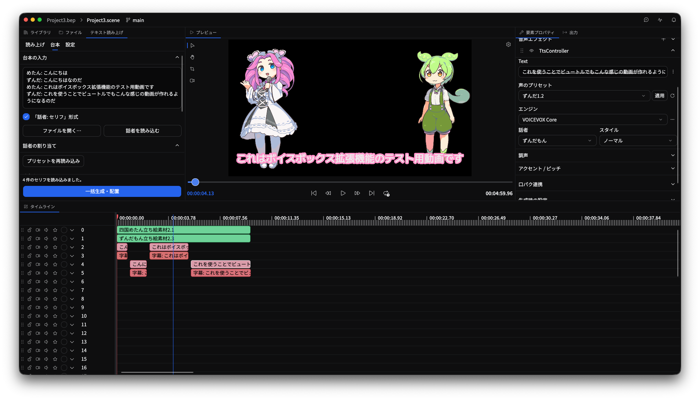
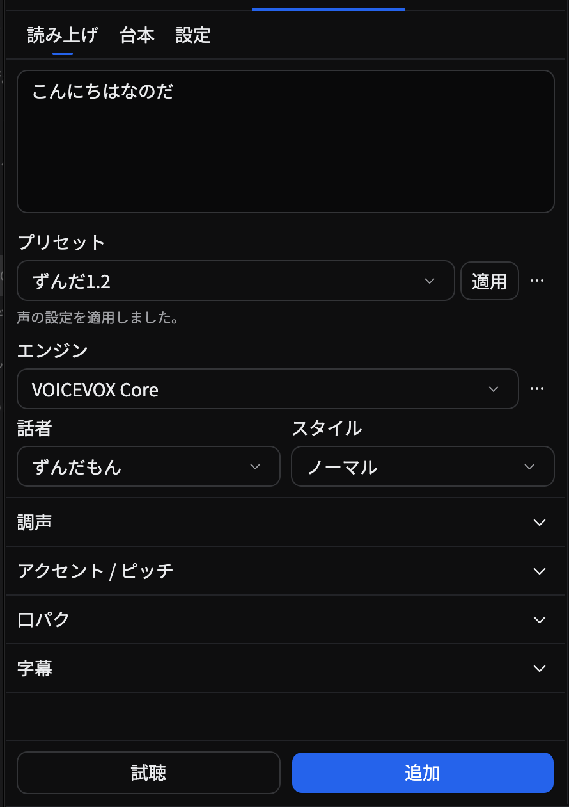
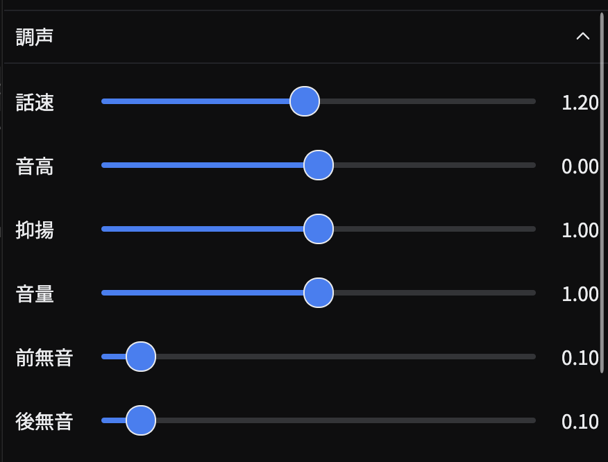
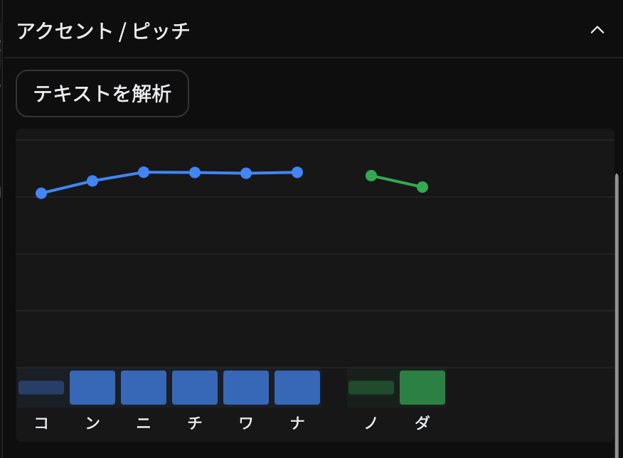
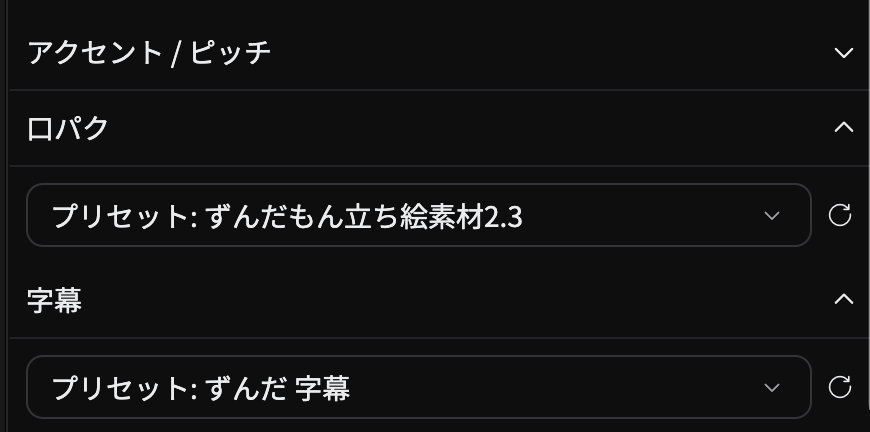
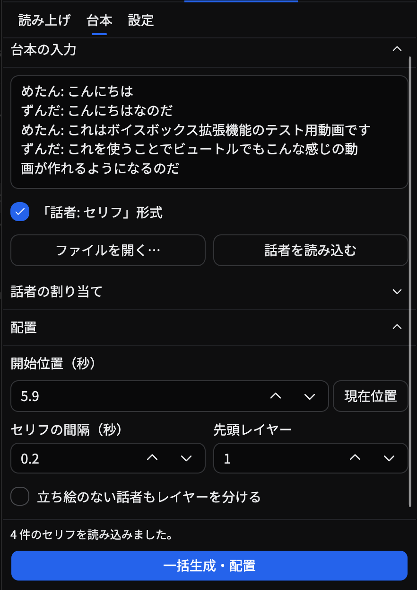
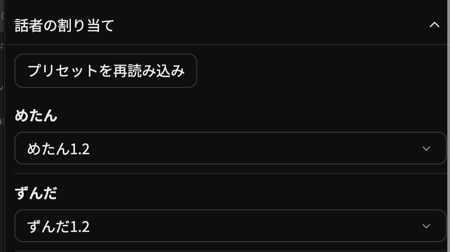

# Beutl.Extensions.Voice

Beutlにテキスト読み上げ機能を追加する拡張機能です。
内蔵の VOICEVOX Core と、外部の VOICEVOX 互換 HTTP エンジンを使用できます。



「テキスト読み上げ」タブの上部で、次の3つの画面を切り替えられます。

| 画面 | 主な用途 |
| --- | --- |
| 読み上げ | テキストの入力、声の調整、試聴、音声の追加、プリセットの管理 |
| 台本 | 複数のセリフの読み込み、話者へのプリセットの割り当て、一括生成・配置 |
| 設定 | インストール済みの外部エンジンの検索・登録 |

読み上げと台本の入力は、画面を切り替えても保持されます。
初めて使う場合は、[エンジンを設定](#エンジンの設定)してから[音声を作成](#新しい音声を作成する)してください。

## 目次

- [エンジンの設定](#エンジンの設定)
- [音声の作成・編集](#音声の作成編集)
- [声のプリセット](#声のプリセット)
- [台本の一括読み込み](#台本の一括読み込み)
- [PSD立ち絵との口パク連携](#psd立ち絵との口パク連携)
- [字幕](#字幕)
- [保存されるデータ](#保存されるデータ)
- [困ったときは](#困ったときは)
- [開発時の検証](#開発時の検証)
- [ライセンス](#ライセンス)

## エンジンの設定

内蔵 Core と外部エンジンは、読み上げ・既存音声の編集・台本のプリセットで共通に利用できます。
**外部エンジンだけを使う場合、内蔵 Core のインストールは不要です。**

### 内蔵の VOICEVOX Core を使う

初回の案内、または「エンジン」横の「…」→「VOICEVOX Coreをインストール…」からセットアップします。

- **今はスキップ**：セットアップを後回しにします。後から同じメニューでインストールできます。
- **今後表示しない**：起動時の通知とタブ内の案内を非表示にします。再起動後も設定を保持します。

### インストール済みの外部エンジンを登録する

VOICEVOX・AivisSpeech・SHAREVOXをインストール済みの場合は、次の手順で登録できます。

1. 「テキスト読み上げ」タブ上部の「設定」を開きます。
2. 標準の接続先を確認し、「接続して追加」で登録します。停止中のアプリは「起動して追加」を使います。

初回の案内の「エンジンを探す…」やエンジンメニューからも、この画面を開けます。
通常の配置場所で見つからないアプリや単体エンジンは「アプリを選択…」から指定してください。

> 検索だけではアプリを起動しません。登録後も、音声生成には外部エンジンの起動が必要です。

### URLを指定して登録する

ポートを変更している場合や、別のPCのエンジンを使う場合は、接続先を直接指定します。

1. 外部エンジンを起動します。
2. 「エンジン」横の「…」→「接続先を追加…」を開きます。
3. 表示名と送信先URLを入力し、「接続して保存」を押します。
4. 話者・スタイルを選んで、試聴・音声生成します。

接続先には任意の HTTP / HTTPS URL を指定できます。標準のURLは次のとおりです。

| エンジン | 標準の接続先URL |
| --- | --- |
| VOICEVOX ENGINE | `http://127.0.0.1:50021` |
| AivisSpeech Engine | `http://127.0.0.1:10101` |
| SHAREVOX ENGINE | `http://127.0.0.1:50025` |

登録したURLはエンジンの下に表示されます。「…」から接続先の編集・削除、接続確認、話者一覧の再読み込みができます。

VOICEVOX ENGINE 0.26.0 と AivisSpeech Engine 1.2.0 で、生成・再生成・台本の一括生成を確認しています。
SHAREVOXなど、話者一覧・AudioQuery・WAV合成のAPIが共通のエンジンにも同じ接続方法を使えます。

## 音声の作成・編集

### 新しい音声を作成する

1. 「テキスト読み上げ」タブの「読み上げ」を開き、本文を入力します。
2. エンジン・話者・スタイルを選びます。保存済みの[声のプリセット](#声のプリセット)も使えます。
3. 必要に応じて「調声」や「アクセント / ピッチ」で声を調整します。
4. 下部の「試聴」で音声を確認し、「追加」でタイムラインに配置します。



「追加」はタイムラインの選択状態にかかわらず、新しい読み上げ要素を作成します。
追加した音声と設定は、まとめて Undo/Redo できます。

### 声を調整する

読み上げタブと既存音声の編集では、共通の編集UIを使います。エンジンが対応する調声項目のみ表示します。

| 設定 | 調整できる内容 |
| --- | --- |
| 調声 | 話速・音高・抑揚・音量・前後無音 |
| アクセント / ピッチ | 「テキストを解析」後、発音ごとのアクセントやピッチを編集 |
| 感情（AivisSpeech） | スタイルの感情表現の強さ |
| 緩急（AivisSpeech） | 話す速さの緩急 |

AivisSpeechの「感情」「緩急」はプリセットにも保存できます。
モーラごとの編集には対応していないため、AivisSpeechでは「アクセント / ピッチ」を表示しません。

| 調声 | アクセント / ピッチ |
| --- | --- |
|  |  |

### 口パクと字幕を設定する

「口パク」で連携するPSD立ち絵を、「字幕」で字幕テンプレートを選択します。
選択内容は声のプリセットに保存できます。
詳しくは[PSD立ち絵との口パク連携](#psd立ち絵との口パク連携)と[字幕](#字幕)を参照してください。



### 既存の音声を編集・再生成する

1. タイムライン上の読み上げ要素の `TtsController` を開きます。
2. 本文・話者・スタイルを変更するか、「声のプリセット」を選んで「適用」します。
3. 必要に応じて「調声」や「アクセント / ピッチ」で調整します。
4. 「再生成」を押し、編集内容を音声に反映します。

「生成時の設定」には、前回の生成に使った値を表示します。再生成前の設定とアクセント編集も要素内に保存され、再度開いて編集を続けられます。

- **再生成で更新するもの**：その要素の音声と生成時設定。
- **保持するもの**：配置・長さ・トリム・エフェクト。
- **アクセントの引き継ぎ**：本文と声が同じ場合は手編集したアクセントを保持し、本文や声を変えた場合は解析し直します。
- **Undo/Redo**：設定の編集、プリセットの適用、音声の再生成に対応します。スライダーのドラッグは1操作として戻せます。

## 声のプリセット

エンジン・話者・スタイルと調声値を保存し、読み上げ・既存音声の編集・台本の生成で再利用できます。
どのプロジェクトでも共通で使え、未保存のプロジェクトやシーンでも保存できます。

### 保存・適用する

1. 「読み上げ」でエンジン・話者・スタイルを選び、声を調整します。
2. プリセット欄の右の「…」→「現在の設定を保存…」で保存します。
3. 再利用するときは、一覧からプリセットを選んで「適用」を押します。

保存対象は、エンジン・話者・スタイル、話速・音高・抑揚・音量・前後無音などの調声値です。
口パクに使うPSD立ち絵と字幕テンプレートも保存できます。
「…」メニューでは、更新・複製・名前の変更・削除と、保存値との差分の確認もできます。

### 既存の音声への影響

プリセットを更新・削除しても、既存の音声・生成時設定・適用済みの設定は変わりません。
既存の音声に変更を反映する場合は、`TtsController` でプリセットを適用し、再生成してください。

プリセット・接続先・話者は表示名ではなく ID で識別するため、異なるエンジンに同じ話者名やスタイル番号があっても混同しません。
保存した声を使えなくなった場合は、[困ったときは](#困ったときは)を参照してください。

## 台本の一括読み込み

複数のセリフにプリセットを割り当て、まとめて音声を生成・配置できます。
使いたい声は、あらかじめ「読み上げ」で[プリセットとして保存](#保存適用する)してください。

### 1. 台本を入力する

「台本」を開き、台本を貼り付けるか「ファイルを開く…」でテキストファイルを読み込みます。
「話者: セリフ」形式と、話者名を含まない1行1セリフの形式に対応しています。

```text
案内役: こんにちは。
ゲスト: よろしくお願いします。
案内役: それでは始めましょう。
```

区切りには全角の「：」も使えます。話者名を含まない台本では、**「話者: セリフ」形式**のチェックを外します。



### 2. 話者にプリセットを割り当てる

1. 「話者を読み込む」を押します。
2. 「話者の割り当て」の選択欄で、名前ごとにプリセットを選びます。
3. 新しく保存したプリセットが見つからない場合は、「プリセットを再読み込み」で一覧を更新します。

選んだプリセットのエンジン・話者・スタイル・調声値を生成に使います。話者ごとに異なる接続先も指定できます。

本文の確認・修正は「台本の入力」で行います。生成には入力欄の最新の内容を使い、同じ話者名への割り当ては保持します。
話者名を変更した場合は、「話者を読み込む」で割り当てを更新してください。



### 3. 生成してタイムラインに配置する

1. 開始位置・セリフ間の間隔・先頭レイヤーを指定します。
2. 立ち絵のない話者は、同一レイヤーに順番に配置するか、「立ち絵のない話者もレイヤーを分ける」を選びます。レイヤーを分ける場合は、話者の登場順に配置します。
3. 「一括生成・配置」を押します。

各セリフの開始位置は、実際の音声の長さと指定した間隔から決まります。
生成後は各要素の `TtsController` で調整・再生成できます。

立ち絵付きプリセットの話者は、次のように配置します。

- 「立ち絵・音声・字幕」の順に配置します。字幕がない話者は「立ち絵・音声」の2段です。
- 新規追加する立ち絵は台本全体の開始から終了まで表示し、話者の組の間に空きレイヤーを挟まず並べます。
- 既存の立ち絵を使う場合はその下から、重なりやロックのない場所に音声と字幕を隣接して配置します。

配置結果の編集・取り消しについては、次の操作に対応しています。

- 生成した要素は、まとめて Undo/Redo できます。
- 途中の失敗・中止・配置先の重なりやロックがある場合は、一部だけを残さず配置を取り消します。
- 台本と割り当てはタブに残り、タブの保存・復元にも対応しています。未割り当ての話者がいても、入力を失わずにプリセットを選んで再実行できます。

## PSD立ち絵との口パク連携

PsdTachie拡張の立ち絵をシーンに追加し、「読み上げ」の「口パク」で選んでから声のプリセットを保存します。口・目のパーツ選択や閾値、位置・サイズなど、立ち絵のオブジェクト設定も保存します。PSDファイル自体はコピーせず、元のファイルを参照します。「台本」では話者ごとにこのプリセットを選ぶだけで、生成時に口パクを設定できます。音声の配置と立ち絵への連携はまとめて Undo/Redo できます。

生成時は、同じPSDファイルを参照する立ち絵がシーンにあれば、その設定を保って連携します。複数ある場合は音声の区間に重なる立ち絵を優先します。見つからない場合はプリセットに保存したオブジェクトを追加し、生成した音声の区間に合わせて表示します。プリセットから追加した立ち絵は後の生成に合わせて前後へ延長し、手動で配置した立ち絵の表示区間は維持します。

立ち絵は長い1つの要素のまま、下のレイヤーに間隔を空けてセリフを並べられます。同じ立ち絵に連携した音声は再生位置に応じて切り替わり、セリフの前後と間では口を閉じます。プリセットを使わず「口パク」でシーン内の立ち絵を直接選んで生成することもできます。連携先の初期値は「連携しない」です。

生成済みの音声は、その要素の `TtsController` で「口パク連携」を開き、立ち絵を選んで「連携」すると連携先を設定・変更できます。

口・目のレイヤーや音量の閾値は立ち絵側で設定します。音声の再生成・差し替え、移動・トリム・速度変更、音声と立ち絵の分割後も連携を引き継ぎます。無音区間や連携音声のない時間は口を閉じ、音声レイヤーのミュート・ソロも反映します。連携した音声が重なる場合は、開始時刻が新しい要素を優先します。

最後の読み上げ要素で「解除」するか別の立ち絵に変更すると、元の口パク音声・開始位置の設定に戻ります。連携の変更は Undo/Redo に対応し、シーンを開き直しても保持されます。PsdTachieを導入していなくても、読み上げと再生成は利用できます。

口パクには音声ファイルの音量を使い、PsdTachieの既存の2段階・3段階の口形を切り替えます。音声エフェクト適用後の音量や音素ごとの母音口形には対応していません。

## 字幕

「読み上げ」の「字幕」で「標準字幕」またはライブラリに保存したテンプレートを選ぶと、音声と同じ区間に字幕を追加します。テキスト単体と、テキストを含む要素・グループのテンプレートを選べます。タイムライン上の要素は候補に含めません。「字幕なし」では音声だけを生成します。字幕付きの声のプリセットを保存すると、「台本」でも話者ごとにその字幕テンプレートを使います。

テンプレートの文字装飾・位置・背景などはコピーして保持します。テキストが1つなら本文を置き換え、複数ある場合は字幕にする箇所に `{text}` を指定します。例えば `「{text}」` と固定の話者名を別々のテキストにできます。音声や以前の読み上げ連携はテンプレートに含めません。

字幕は対応する音声の直下のレイヤーに、同じ開始位置・長さで配置します。配置先に既存の要素やロックがある場合は、音声と字幕をまとめて空いている連続したレイヤーへ配置します。

音声の `TtsController` で再生成すると、関連する字幕の本文も更新します。配置後に調整した見た目・表示区間は保持し、音声と字幕の更新をまとめて Undo/Redo できます。字幕の「字幕連携」を無効にすると本文の更新を停止できます。

## 保存されるデータ

| データ | 保存先・保存内容 |
| --- | --- |
| 外部エンジンの接続先 | Beutlのホームディレクトリ内の `voice/engines.json`。プロジェクト共通の設定です。 |
| 声のプリセット | Beutlのホームディレクトリ内の `voice/presets.json`。プロジェクト共通の設定です。 |
| Coreのセットアップ案内の表示設定 | Beutl標準の拡張機能設定 |
| 読み上げ・台本の入力と話者の割り当て | タブの保存時にまとめて保存 |
| 生成した読み上げ要素 | 本文・話者・調声値・最終 AudioQuery・プリセットの識別情報。再生成前の編集内容も要素内に保存します。 |

## 困ったときは

### 外部エンジンに接続できない

外部エンジンを起動し、エンジンの下に表示される接続先URLを確認して再試行してください。
接続できない場合も、入力・設定・既存音声は保持されます。

### プリセットに保存された接続先や声が見つからない

保存された接続先が見つからない場合は、次の手順で復元できます。

1. 該当するプリセットを適用します。
2. 「エンジン」横の「…」→「接続先を編集…」からURLを設定します。

この方法では、元の接続先IDを保って復元できます。
「接続先を追加…」では同じURLでも新しいIDになるため、追加した場合は接続先・話者を選び直してプリセットを更新してください。
接続先に保存された声がない場合も、話者を選び直してください。

### 古い読み上げ要素を再生成できない

生成時設定がない古い要素は、`TtsController` で話者を選ぶかプリセットを適用すると再生成できます。

## 開発時の検証

リポジトリのルートで実行します。

```sh
dotnet test tests/Beutl.Extensions.Voice.Tests -c Release
```

### 追加の検証に使う環境変数

| 環境変数 | 指定する値 | 検証・出力内容 |
| --- | --- | --- |
| `VOICE_TEST_CAPTURES` | 画像の出力先ディレクトリ | 台本読み込み、調声、`TtsController` の設定を展開した Headless の画面画像を保存 |
| `VOICEVOX_TEST_HOME` | Core・辞書・モデルを導入済みのディレクトリ | 実音声の生成・再生成・複数話者の一括配置・設定の保持・Undo/Redo |
| `VOICE_HTTP_VOICEVOX_URL` | 起動済み VOICEVOX ENGINE のURL | 実音声での接続・生成・再生成・台本配置 |
| `VOICE_HTTP_AIVIS_URL` | 起動済み AivisSpeech Engine のURL | 実音声での接続・生成・再生成・台本配置 |
| `VOICE_HTTP_SHAREVOX_URL` | 起動済み SHAREVOX ENGINE のURL | 実音声での接続・生成・再生成・台本配置 |

Coreや各HTTPエンジンの環境変数が未指定の場合、そのエンジンを使う実音声テストをスキップします。
HTTPの互換性・切り替え・通信失敗・UIの回帰テストは、ローカルのテストサーバーで実行します。

## ライセンス

[MIT License](LICENSE)
